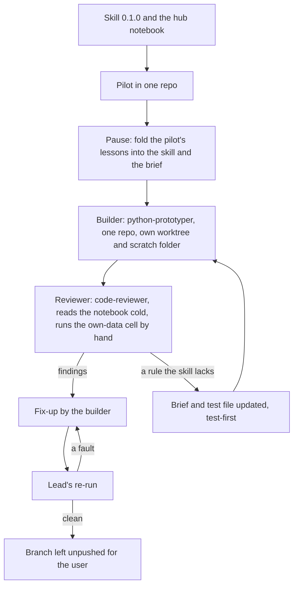

# Session: The Case-Notebook Update in Detail

**Date**: 2026-11-17 (Nidhogg, late morning)
**Branch**: main
**Tags**: #session #doctrine #testing #decision-science #agents #docs

**Documents**: [SKILL.md](../../.claude/skills/writing-tours-and-case-notebooks/SKILL.md) and its five sidecars; [test_case_notebooks.py](../../tests/unit/test_case_notebooks.py); [test_case_notebook_module_port.py](../../tests/unit/test_case_notebook_module_port.py); [visualization.py](../../src/myproject/decision_science/visualization.py); [cases_how_a_ranking_goes_wrong.ipynb](../../notebooks/cases_how_a_ranking_goes_wrong.ipynb)
**References**: [tasks.md](../tasks.md); [gaps.md](../gaps.md), rows G16 and G17; [doctrine-updates.md](../doctrine-updates.md), the three notebook entries of 2026-11-14 and 2026-11-16
**Follows**: [20261116_case_notebooks_and_the_confidence_section.md](20261116_case_notebooks_and_the_confidence_section.md)

---

## Summary

This is the long record of the case-notebook update, written at the user's request at `/session-end`. The update is five commits, `68bd300..2835a7a`, which the user pushed to `origin/main` at 10:19 CST on 2026-11-17. It carries a draft skill, a test file that holds a case notebook to fifteen rules, two displays, and the hub's own case notebook. Beside it, outside this repo, thirteen sibling repos each hold a first case notebook on an unpushed branch.

The session doc it follows is the short record, written overnight in two parts. This one adds what that one left out: each file and what it holds, each rule and where it came from, how the rollout was run, the thirteen notebooks in numbers, and the lessons in the order they were learned. It also corrects one count the earlier doc states.

| Measure | Value | How measured, 2026-11-17 |
|---|---|---|
| Commits in the update | 5 | `git log --oneline 68bd300..2835a7a` |
| Files changed, lines added | 19 files, 2,592 insertions, 7 deletions | `git diff --shortstat 68bd300..HEAD` |
| Hub suite | 688 passed, 1 warning | `.venv/bin/pytest -q` |
| Hub and remote | same commit, `2835a7a` | `git rev-parse HEAD origin/main` and `git ls-remote origin refs/heads/main` |
| Sibling branches clean, on no remote | 13 of 13 | `git status --porcelain` and `git branch -r --contains HEAD` in each worktree |
| Sibling branches on the current test file | 5 of 13 | `grep 'Module version'` in each copy |

---

## Work Completed

### 1. What the push carried

| Commit | Tag | Holds |
|---|---|---|
| `a85ac9e` | feat | `passage_chart`, `slope_chart` and the label-spreading helper `_spread` in `visualization.py`, exported from the package, with their tests |
| `79f156a` | test | The hub's case notebook; `test_case_notebooks.py` at 0.7.2; the port tests that show each rule failing alone; one test added to `test_scorer.py`; the README line |
| `cdf13c6` | doc | The draft skill at 0.3.0 with five sidecars; a "Level 0 Drafts" section in `SKILLS_FRAMEWORK.md`; the roster line in `.claude/README.md` |
| `12cd158` | doc | The first session doc; the Focus and five tasks in `tasks.md`; gap rows G16 and G17 |
| `2835a7a` | doc | The last reviews' lessons folded into the skill; the session doc's addendum |

The skill sits in "Level 0 Drafts" so that `scripts/adopt_doctrine.py` does not copy it to a consumer. When it was first listed in the propagated roster, a pin in `tests/unit/test_adopt_doctrine.py` failed. The Drafts section is the answer to that failure, and it makes "not yet doctrine" a state the suite can see.

### 2. The two kinds of notebook

A repo's notebooks answer two questions. A **tour** answers "what does this repo do?" by walking its main path once, from a raw input to a result. A **case notebook** answers "why does it do it that way?" by stopping at each place where the obvious rule gives a different answer, running that rule beside the repo's, and asserting the difference.

| | Tour | Case notebook |
|---|---|---|
| Reach | Breadth: the whole main path, one route | Depth: three to five places on it |
| File name | `tour_from_<input>_to_<result>.ipynb` | `cases_<what_goes_wrong>.ipynb` |
| A section is | One step of the path | One case: fixture, naive rule, repo's rule, the difference, the source |
| Held by | `tests/unit/test_notebooks.py` | That file and `tests/unit/test_case_notebooks.py` |

A walkthrough and a problem set are teaching forms; the skill names them and makes no rule for them. A demo is not a kind: it is a tour with an audience.

### 3. The skill, file by file

| File | Lines | Holds |
|---|---|---|
| `SKILL.md` | 124 | The kinds, the kernel of nine rules, the three levels, the three lenses, which test or review holds each rule, and "What the Suite Cannot See" |
| `TOURS.md` | 97 | The shape of a tour, what every notebook owes, the table of ten ways a cell's result can depend on the host, the rules for asserts, and the own-data cell |
| `CASES.md` | 173 | The parts of a case, the four section shapes (Case, Known defect, Limit, Tradeoff), the three source kinds, the gate for whether a repo is ready for a case notebook, where to find cases, and the questions a reviewer asks |
| `CONFIDENCE.md` | 116 | The confidence section: the table of doubts by level, the kinds of doubt, the cell that runs one doubt through to the report, statistics over draws, and what a reader may conclude |
| `DISPLAYS.md` | 99 | Which display suits each level, each comparison and each kind of doubt; where a figure's code lives; named failures |
| `REVIEWING.md` | 65 | What only a second reader finds, the review protocol, how to brief an agent, and the lead's own checks, the socket count among them |

The kernel, with where each rule came from:

| # | Rule | Origin |
|---|---|---|
| 1 | The suite runs every cell over committed fixtures; own data stays behind a guard committed as `None` | The tour entry of 2026-11-14 |
| 2 | Show the data at three levels: as it arrives, as it is handled, as it is reported | The user, when asking for the skill |
| 3 | A tour walks the main path once; a case stops where the obvious rule differs | `assay`'s first case notebook |
| 4 | A case runs the naive rule beside the repo's and asserts the difference | `assay`'s pattern, tightened after its one test rule passed `assert naive == naive` |
| 5 | Every case names its source, and an incident quotes its record | The lead proposed it as a must; the user agreed. The quotation half came from a review |
| 6 | An assert must fail if the sentence above it were false | The reviews: most Criticals were true asserts under false sentences |
| 7 | A figure comes from the package, never from a cell; under about twenty numbers, a table | The display skill, and the tour test's ban on charting imports |
| 8 | Write for two readers | The user: "a casual and advanced user" |
| 9 | Say how sure, at each level, and run one doubt through to the report | The user, partway through the rollout |

**Three levels.** A pipeline shows them plainly: the raw record, the staged record, the report. A library has them too: the arguments, the validated object, the returned value. Rule 2 asks for one raw record printed whole, because a reader who has not seen the input cannot judge what was done to it.

**Three lenses**, from `assay`'s three planned notebooks. Construction: is the thing built the way the obvious reading says? Validity: does the number mean what its label says? Scope: where does the method stop working?

**The source line.** A case with no source is an invented example. Three kinds are allowed. `Incident:` names a commit or a record in the repo and quotes it in double quotes. `Design:` names a decision record or a test. `Literature:` names a published source. The quotation rule exists because a builder's paraphrase of a record was wrong in every repo where the rule was later applied.

**The confidence section.** It holds a table with one row per doubt, grouped by level. Each row gives the doubt, its kind (measured, measured over an assumed range, estimated, not known, or exact), its size, and what the repo does about it. Then one doubt is run through the pipeline to the report, so the reader sees what it does to the answer. At the arrival level the doubts are provenance, source and conflict. At the handling level they are procedure, bias and representation. At the report level the question is what the report states and what it withholds.

### 4. The test file: fifteen rules

`tests/unit/test_case_notebooks.py`, 343 lines, module version 0.7.2. A consumer copies it and reports the version. Each rule has a port test that builds a small repo, breaks one thing, and shows that rule failing alone.

| Rule | Fails when |
|---|---|
| `test_there_is_a_case_notebook_to_hold` | The folder holds no `cases_*.ipynb` |
| `test_it_holds_at_least_one_case` | No section is a case |
| `test_every_heading_is_one_the_module_knows` | A heading is one the file cannot place. A misspelled heading once hid a case from every other rule |
| `test_it_says_how_sure` | There is no confidence section, or it asserts nothing |
| `test_every_section_states_its_parts` | A case lacks its fixture, its two rules, or its source |
| `test_every_case_asserts_its_naive_answer_against_the_repos` | The naive answer is typed as a literal, read back from the repo's answer, or defined and never called |
| `test_every_limit_pins_the_present_state` | A limit describes what the repo cannot do and no assert shows it |
| `test_every_source_says_what_kind_it_is` | A source is not `Incident:`, `Design:` or `Literature:` |
| `test_every_source_names_a_test_that_exists` | A source names a test the repo does not have |
| `test_every_file_a_section_names_exists` | A section names a path that does not resolve |
| `test_a_limit_that_cites_a_gap_finds_it_open` | A limit cites a gap row that is closed or missing |
| `test_every_incident_names_its_record` | An incident names no commit and no file |
| `test_every_commit_a_source_names_is_in_the_history` | A named commit is not in the repo's history |
| `test_every_incident_quotes_its_record` | The quoted words are not in the record. Without git it skips, visibly |
| `test_the_own_data_branch_runs_over_a_committed_fixture` | The own-data cell crashes when its guards point at a committed file |

The file began the evening with five rules. Each of the other ten was added for a fault a builder or a reviewer showed, and each was written test-first. The holes found along the way, all now held: a naive answer assigned through a tuple; a source line that swallowed the next cell; a guard written with a type annotation that the probe did not see; an empty accumulator passed as a computed answer.

Two limits of the file are recorded as gaps. It runs the own-data branch and discards the output, so it sees a crash and nothing else (G17). And every notebook it has held was built with a brief beside the skill (G16).

### 5. The two displays

Both live in `src/myproject/decision_science/visualization.py`, since rule 7 leaves a figure nowhere else. Both were driven by failing tests and then looked at as rendered.

**`passage_chart(scorer, alternatives, title, source=None, highlight=None)`** shows the three levels in one figure. There is one panel per criterion: the raw measurement runs across, the utility runs up, and each alternative is a labelled point on the criterion's value curve. Every panel shares the utility scale. A panel's width is its weight, so the weights need no key. A last panel carries the total.

**`slope_chart(panels, title="", source=None, highlight=None, value_format="{:.3f}")`** sets two rules side by side. It draws no axis, no grid and no legend, because each item is labelled with its name and value at both ends. An item present in one column only is a point with no line. Panels share one scale, so the white space in the naive panel is part of the comparison.

Both take a `highlight` list and draw the rest in grey with their labels kept. `_spread(values, gap, low, high)` moves crowded labels apart and keeps them centred on their marks; it moves a label and never shrinks the type.

### 6. The hub's case notebook

`notebooks/cases_how_a_ranking_goes_wrong.ipynb`: 25 cells, 28 asserts, over the tour's YAML fixtures.

| Section | The obvious rule | What the package does | Source kind |
|---|---|---|---|
| Case 1 | Add the raw measurements | Converts each to a utility first, so units cannot outvote each other | Design |
| Case 2 | Scale each criterion from the worst to the best alternative present | Scales against the model's stated range. Withdrawing a dominated site changes the naive leader and moves nothing in the package | Design. The text names rank reversal and says it cites no paper |
| Case 3 | The exponential value function as the textbook prints it, at a rate near zero | Returns the linear limit. The textbook form raised `ZeroDivisionError` under about 2.2e-16 and returned a wrong utility at 1e-12 | Incident, quoting commit `acdab6e` |
| Case 4 | Read a criterion's weight as its influence | Warns when the alternatives' utilities on a criterion span a narrow range, since a heavy criterion they agree on decides nothing | Design |
| Limit | | The weights are an input the package does not check against a person's preferences | |
| Confidence | | One site's flood record is moved three years either way. The leader holds. Second and third place swap, across a margin the ranking prints as 0.004 | |
| Own data | | `MY_MODEL` and `MY_ALTERNATIVES`, committed as `None` | |

The first draft of this notebook stated two figures that its own asserts then refuted. Both were fixed before the commit.

### 7. How the rollout ran

Each repo's work happened in a worktree outside the projects tree, on a `topic/case-notebook` branch that is on no remote. No builder was allowed to change product code or add a dependency. A defect a notebook found was pinned by an assert on the present behaviour and filed as a task in that repo.

The lead's re-run, per branch:

1. The suite, or the named tests where the suite is slow, drives a device, or reaches the network.
2. The two notebook test files under `TZ=UTC` and `TZ=Asia/Tokyo`.
3. The same under a second `PYTHONHASHSEED`.
4. A clean tree: `git status --porcelain` prints nothing.
5. No remote holds the branch.
6. No file under the product's source folders changed.

Two files sit beside the worktrees and stay outside every repo, because they name sibling repos and their defects:

- **The brief**, 596 lines and 135 numbered points at the end, having started at 15. Every builder read it. It grew each time a review returned, and it overlapped itself by the end; the skill is its consolidated form.
- **The morning file**, 1,117 lines: fourteen items to read first, numbered 0 to 13, a table of the thirteen branches, the rulings only the user can make, one entry per repo, and forty after-action notes in the order they were written.

### 8. The thirteen notebooks in numbers

Measured on 2026-11-17 from each branch's notebook, with a script that parses the cells. Repo names are withheld here; the morning file has them.

| Measure | Total | Smallest | Largest |
|---|---|---|---|
| Sections headed as a case | 59 | 3 | 5 |
| Sections headed as a limit | 11 | 0 | 3 |
| Asserts, counted from the syntax tree | 740 | 43 | 85 |
| Cells | 364 | 24 | 34 |
| Notebooks with a confidence section | 13 of 13 | | |

| Copy of the test file | Branches |
|---|---|
| 0.7.2, the current file | 5 |
| 0.7.0 | 2 |
| 0.6.2 | 2 |
| 0.6.1 | 1 |
| 0.6.0 | 3 |

The eight branches on older copies passed the rules of their day. Copies before 0.7.0 lack the rule that runs the own-data branch; whether a given copy holds the quotation rule was not re-checked today.

Ten of thirteen reviews held at least one Critical finding. One notebook was ruled padded and cut from five cases to three.

### 9. The lessons, in the order they were learned

1. **The first test rule passed `assert naive == naive`.** A rule that checks for the word "naive" checks nothing. The test file now requires the naive answer to be computed.
2. **A misspelled heading hid a case.** The rules skipped a section they could not classify. An unknown heading now fails.
3. **Two builders shared one scratch folder.** One's mutation script ran against the other's worktree. Each agent now gets its own scratch folder and mutates a clone.
4. **The gate could not say "not ready".** A repo with three honest cases produced five. The gate now asks whether each case has a source before it asks how many there are.
5. **The mechanical record was clean and the notebook was wrong.** This is the main finding. Negating each assert is a floor. It cannot see a true assert under a false sentence, and that is where ten of thirteen reviews found a Critical.
6. **Paraphrase drifts.** Three of four sources in one notebook misdescribed their records. An incident now quotes its record, and the test finds the quotation in the record.
7. **The own-data cell is where a notebook does harm.** The suite never ran it, and most Criticals were there: a score the product's own report withholds; three all-clears printed after reading nothing. The suite now runs the branch once. A hand run is still required.
8. **A confidence finding can be the host.** One headline number was this machine's offset from UTC. Another held on one block of thirty draws and on two of ten others. Run under two timezones and two hash seeds, and state a rate with its count.
9. **A design doc can be out of date.** A direction quoted accurately from a design doc was listed as undecided in the same repo's gap register. Read the register before citing a decision.
10. **One control on one field is not a rule about a class of input.** "Infinity is rejected" was true for one field and false for another, in the sentence that told a reader a defect was small.
11. **A folder named `unit` is not a network policy.** Six unit tests in one repo look up a public service and pass when refused. Block every socket call and count the attempts.

### 10. Corrections to the earlier record

| Stated | Where | What is so |
|---|---|---|
| "Branches on the current test file (0.7.2): 6 of 13" | The addendum of the doc this one follows, and the lead's closing message that night | 5 of 13, measured today by `grep 'Module version'` in each copy. The lead miscounted |
| "Seven branches carry an older copy" | The same addendum's next steps, and `tasks.md` by implication | Eight |
| "The hub's five unpushed commits" | The same addendum | The user pushed them at 10:19 CST on 2026-11-17 |

The earlier doc is a record and is not rewritten. Its other four corrections stand as it states them.

---

## Claims

| Claim | State | Evidence |
|---|---|---|
| The hub suite passes | tested | `.venv/bin/pytest -q` → `688 passed, 1 warning in 22.11s`, at `2835a7a` |
| The case test file, its port tests and the display tests pass | tested | `.venv/bin/pytest -q tests/unit/test_case_notebook_module_port.py tests/unit/test_case_notebooks.py tests/unit/test_visualization.py` → `123 passed in 16.38s`, at `2835a7a` |
| The update is on the remote | observed | `git ls-remote origin refs/heads/main` → `2835a7a9fe80...`, equal to `git rev-parse HEAD`; `git reflog show origin/main` → `update by push` at 2026-11-17 10:19:38 -0600 |
| Thirteen sibling branches are clean and on no remote | observed | one loop over the thirteen worktrees printed `dirty=0 remote=0` on every line, 2026-11-17 |
| Five of thirteen branches carry test file 0.7.2 | observed | `grep -oE 'Module version [0-9.]+'` in each copy, tallied: 3 at 0.6.0, 1 at 0.6.1, 2 at 0.6.2, 2 at 0.7.0, 5 at 0.7.2 |
| Every sibling notebook has a confidence section | observed | the cell-parsing script found one such heading in each of 13 notebooks |
| The orientation surfaces name no missing file | tested | `/pcc` check 5, file pass → 0 MISSING lines |
| `config/project.yaml` parses | tested | `yaml.safe_load` returned without error |
| The whole suite passes in every sibling branch | UNVERIFIED | in five the lead ran named tests only, on 2026-11-16; nothing was re-run there today |
| The hub's case notebook and displays are sound | UNVERIFIED | no second reader has reviewed them, and no notebook was opened in a front end |

Overclaims the user caught this session: 0

Overclaims a reviewer caught this session: 0

The lead corrected one of its own counts today, the "6 of 13" above. Nobody had acted on it.

---

## Key Decisions

| Decision | By | Rationale |
|---|---|---|
| Push the hub's five commits | the user | Done by the user on 2026-11-17 |
| Write this record as a new doc, leaving the earlier one as it stands | the lead | A session doc is a record; a correction is a new record that points back |
| Keep sibling repo names and per-repo findings out of this doc | the lead | The hub is public; the morning file holds them |

---

## Next Steps

1. The user rules on each of the thirteen `topic/case-notebook` branches: merge, change, or drop. One public sibling needs its commits' author identity checked before any push; the morning file's opening items say which.
2. The user reads the product defects the notebooks found, in the morning file, and decides which become work in their own repos.
3. One notebook is built from the skill's six files alone, with no brief, and reviewed. That closes gap G16 and decides whether the skill goes to 1.0.0.
4. `code-reviewer` reviews the hub's own case notebook and its two displays, and someone opens the notebook in a front end.
5. `test_notebooks.py` gains runs under two timezones and two hash seeds. Two sent entries pin that file at `cb7617d`, so the change ships as a correction entry.
6. Eight branches carry an older copy of the case test file. Level each when it is merged, or accept it as it stands.
7. The user decides whether the two 2026-11-16 doctrine entries go to this box's consumers.
